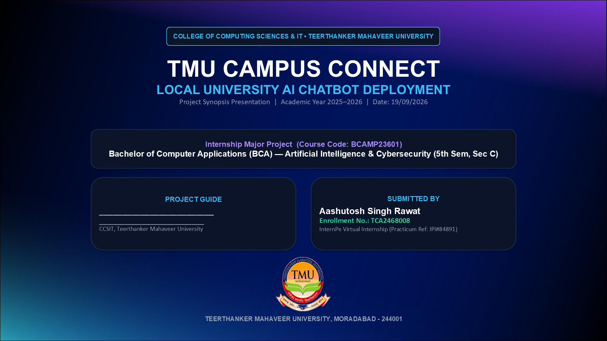
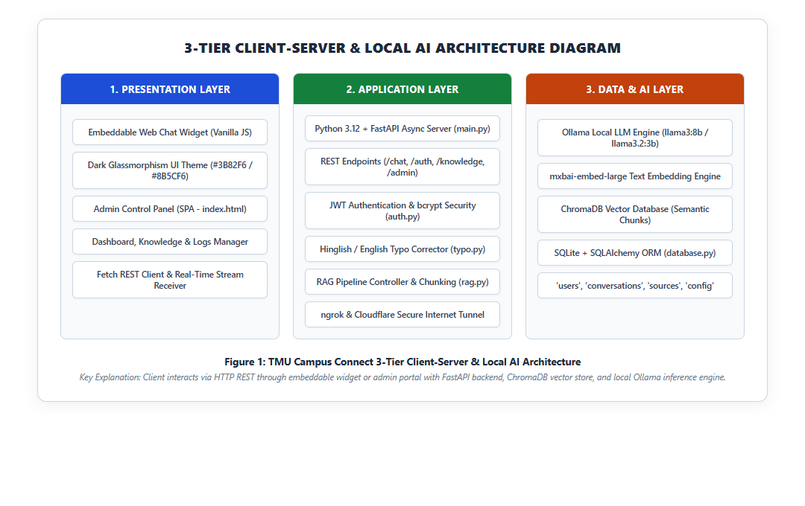
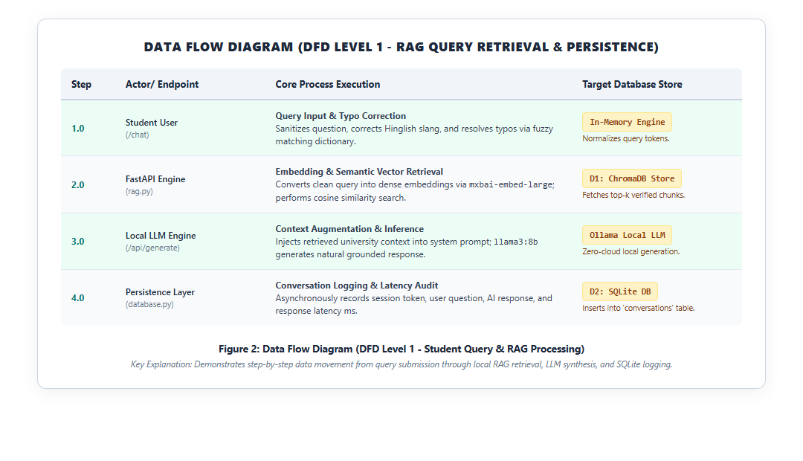
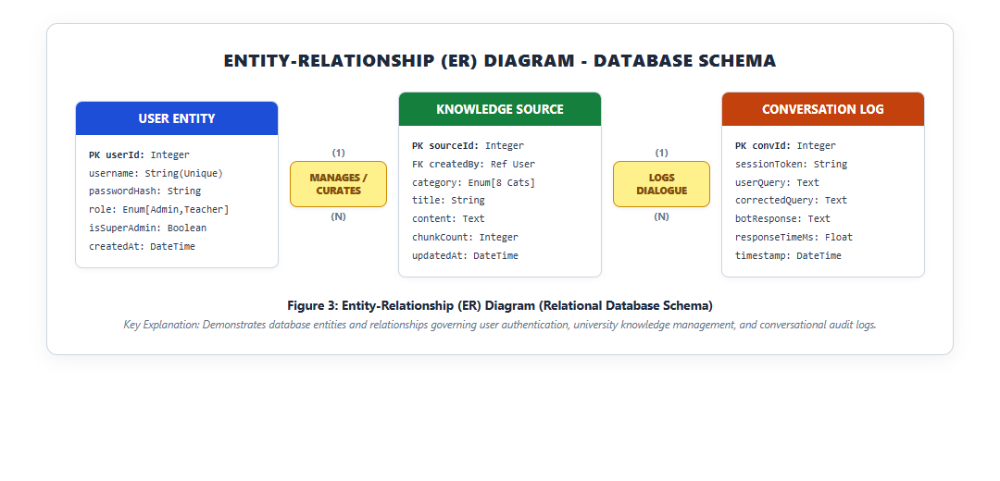

<div align="center">


# TMU CampusConnect 🎓
### *Intelligent, Privacy-Preserving On-Device AI Campus Assistant*

[](https://www.python.org/downloads/release/python-3128/)
[](https://fastapi.tiangolo.com/)
[](https://ollama.com/library/llama3.2:3b)
[](https://www.trychroma.com/)
[](https://www.langchain.com/)
[](https://www.microsoft.com/windows)
[](LICENSE)

<br/>



<br/>

[📖 Overview](#what-is-this) • [🚨 The Problem](#the-problem) • [💡 The Solution](#the-solution) • [✨ Features](#key-capabilities) • [🏛 Architecture](#system-architecture) • [🚀 1-Click Install](#one-click-installer--setup) • [🛠 Tech Stack](#software--technologies) • [🌐 Live Demo](#live-public-access)

</div>

---

## What is This?

**TMU CampusConnect** is an enterprise-grade, localized campus intelligence system engineered for **Teerthanker Mahaveer University (TMU)**. Developed at the **College of Computing Sciences and Information Technology (CCSIT)**, it provides instant, accurate, 24/7 answers to academic, admissions, hostel, fee, and administrative inquiries.

Unlike generic cloud chatbots that risk student privacy and incur recurring subscription fees, TMU CampusConnect runs **100% on-premise** on local Windows hardware using open-source Large Language Models via [Ollama](https://ollama.com/). It couples **Meta LLaMA 3.2 (3B)** with a **Retrieval-Augmented Generation (RAG)** pipeline backed by [ChromaDB](https://www.trychroma.com/) and [FastAPI](https://fastapi.tiangolo.com/).

---

## The Problem

Universities face substantial operational overhead handling repetitive inquiries from prospective students, parents, and enrolled candidates:
* **Information Fragmentation:** Important details are scattered across disparate PDF notices, website subpages, circulars, and departmental notice boards.
* **Administrative Bottlenecks:** During peak admissions and examination seasons, administrative desks and call lines become severely congested.
* **Cloud Costs & Privacy Concerns:** Cloud LLM APIs (OpenAI, Anthropic) impose per-token billing, rate limiting, and transmit internal campus records over external networks.

## The Solution

TMU CampusConnect resolves these challenges through a localized, private, and automated AI architecture:
* **Zero Cloud Costs:** Completely free to run with zero recurring API tokens or third-party subscriptions.
* **Strict Grounding (Anti-Hallucination):** Uses semantic vector similarity retrieval over verified TMU official handbooks before generating any response.
* **100% Data Confidentiality:** All conversational logs, user telemetry, and internal policies remain confined to the university's local database.
* **Universal Embeddability:** A single JavaScript line injects the interactive assistant into any TMU website, ERP portal, or learning management system.

---

## Key Capabilities

```
┌────────────────────────────────────────────────────────────────────────┐
│                      TMU CAMPUSCONNECT CORE MODULES                    │
├──────────────────┬──────────────────┬──────────────────┬───────────────┤
│ 🎯 RAG Knowledge │ 🛡️ RBAC Security │ 📊 Admin Portal  │ 🌐 Embeddable │
│ Multi-source TMU │ JWT auth with    │ Live telemetry,  │ Lightweight   │
│ handbooks, fees, │ bcrypt hashing,  │ user moderation, │ floating chat │
│ hostels & exams  │ 3 user tiers     │ & source manager │ widget script │
└──────────────────┴──────────────────┴──────────────────┴───────────────┘
```

* **📚 Pre-Loaded University Knowledge Base:** Includes 13 verified TMU documents, course catalogs, hostel codes of conduct, fee schedules, and 284 conversation benchmarks.
* **⚡ Blazing Fast Local Inference:** Powered by Meta LLaMA 3.2 (3B) with sub-second time-to-first-token on standard consumer hardware.
* **🔍 High-Accuracy Semantic Search:** Utilizes `mxbai-embed-large` 1024-dimensional embeddings for nuanced contextual document retrieval.
* **👥 Multi-Tier Role-Based Access Control:**
  * **Admin:** System monitoring, user creation, global configuration, raw database logs.
  * **Teacher / Staff:** Upload, update, or remove departmental notices and syllabus PDFs.
  * **Student / Visitor:** Public chat widget for conversational university queries.
* **🚀 Universal Zero-Config Installer:** Bundled one-click automation that detects hardware, auto-installs missing Python 3.12 / Ollama runtimes, pulls AI brains, and self-heals dependency conflicts.

---

## System Architecture

The project employs a modular, high-throughput RAG pipeline decoupling the user presentation tier, web API gateway, vector store, and local neural inference engine:

<div align="center">
  
  <p><i>Figure 1: TMU CampusConnect End-to-End System Architecture</i></p>
</div>

### Data Flow Diagram (DFD)

<div align="center">
  
  <p><i>Figure 2: Level-1 Data Flow Diagram for Query Ingestion & Semantic Retrieval</i></p>
</div>

### Entity-Relationship Model (ERD)

<div align="center">
  
  <p><i>Figure 3: Relational Schema for Users, Roles, Knowledge Chunks, and Interaction Logs</i></p>
</div>

---

## Software & Technologies

Every component in TMU CampusConnect is carefully selected for performance, local execution, and license flexibility:

| Category | Software / Library | Version | Role & Official Documentation |
|---|---|---|---|
| **Programming Language** | [Python](https://www.python.org/) | `3.12.8` | Core runtime engine • [python.org/downloads](https://www.python.org/downloads/release/python-3128/) |
| **Local LLM Engine** | [Ollama](https://ollama.com/) | `v0.3+` | Local GPU/CPU model execution server • [ollama.com](https://ollama.com/) |
| **Language Model** | [Meta LLaMA 3.2](https://ollama.com/library/llama3.2:3b) | `3B` | 3.2-Billion parameter instruct LLM • [ollama.com/library/llama3.2:3b](https://ollama.com/library/llama3.2:3b) |
| **Embedding Model** | [mxbai-embed-large](https://ollama.com/library/mxbai-embed-large) | `334M` | 1024-dimensional semantic embedding model • [mixedbread.ai](https://www.mixedbread.ai/) |
| **Backend Framework** | [FastAPI](https://fastapi.tiangolo.com/) | `>=0.111.0` | Asynchronous high-performance REST API • [fastapi.tiangolo.com](https://fastapi.tiangolo.com/) |
| **ASGI Web Server** | [Uvicorn](https://www.uvicorn.org/) | `>=0.29.0` | Lightning-fast ASGI HTTP server • [uvicorn.org](https://www.uvicorn.org/) |
| **Vector Database** | [ChromaDB](https://www.trychroma.com/) | `>=1.5.0` | Open-source embedding database for RAG • [trychroma.com](https://www.trychroma.com/) |
| **AI Orchestration** | [LangChain](https://www.langchain.com/) | `>=0.2.1` | RAG chunking and context fusion • [langchain.com](https://www.langchain.com/) |
| **Relational Database** | [SQLite](https://www.sqlite.org/) | `3.x` | Embedded relational database for users & logs • [sqlite.org](https://www.sqlite.org/) |
| **ORM Layer** | [SQLAlchemy](https://www.sqlalchemy.org/) | `>=2.0.30` | Enterprise Python SQL toolkit • [sqlalchemy.org](https://www.sqlalchemy.org/) |
| **Authentication** | [Passlib](https://passlib.readthedocs.io/) & [Bcrypt](https://pypi.org/project/bcrypt/) | `1.7.4 / 4.0.1` | Cryptographic password hashing • [passlib docs](https://passlib.readthedocs.io/) |
| **Document Processing** | [PyPDF](https://pypdf.readthedocs.io/) | `>=4.2.0` | Ingestion of official university PDF policies • [pypdf.readthedocs.io](https://pypdf.readthedocs.io/) |
| **Internet Tunneling** | [ngrok](https://ngrok.com/) | `v3.39+` | Secure public internet tunneling for remote access • [ngrok.com](https://ngrok.com/) |

---

## One-Click Installer & Setup

TMU CampusConnect includes a fully automated Windows installer with a modern graphical interface inspired by WingetUI.

```
                    ┌──────────────────────────────────┐
                    │     ONE_CLICK_INSTALLER.bat      │
                    └─────────────────┬────────────────┘
                                      │
              ┌───────────────────────┴───────────────────────┐
              ▼                                               ▼
    [Offline Mode Available]                         [Online Auto-Fetch]
Bundled Python 3.12 & Ollama                      Downloads from official repos
              │                                               │
              └───────────────────────┬───────────────────────┘
                                      ▼
                  ┌───────────────────────────────────────┐
                  │ 1. Hardware & RAM Inspection (8+ GB)  │
                  │ 2. Silent Python 3.12 Engine Setup    │
                  │ 3. Silent Ollama Setup & Daemon Boot  │
                  │ 4. Verification of llama3.2 & mxbai   │
                  │ 5. Virtualenv & Self-Healing Packages │
                  │ 6. Pre-filled Config & 13 Data Chunks │
                  │ 7. Desktop Launchers & Quick Start    │
                  └───────────────────────────────────────┘
```

### Installation Steps:
1. Clone or download this repository:
   ```bash
   git clone https://github.com/AashuTmuCollege-Account/tmu-campusconnect.git
   cd tmu-campusconnect
   ```
2. Double-click **`ONE_CLICK_INSTALLER.bat`**.
3. The installer inspects your system, resolves all dependencies, and creates a desktop shortcut: **`TMU CampusConnect.lnk`**.

---

## Everyday Launchers

| Script | Purpose |
|---|---|
| **`START_CHATBOT.bat`** | Ensures Ollama daemon is active, launches the FastAPI server on `http://localhost:8000`, and opens the **Admin Panel** in your browser. |
| **`START_INTERNET_TUNNEL.bat`** | Boots the secure ngrok tunnel on port 8000 using your permanent public address. |
| **`DOCTOR_AND_REPAIR.bat`** | Comprehensive diagnostic utility that automatically fixes port collisions, missing packages, and model sync issues. |

---

## Live Public Access & Mobile Scan

When running with the internet tunnel enabled (`START_INTERNET_TUNNEL.bat`), anyone can access the chatbot and admin portal directly from their smartphone or desktop browser.

| Application | Live Direct Link & Info | Quick Scan (Mobile QR Code) |
| :--- | :--- | :---: |
| **🎓 TMU Amber Chat Widget**<br>*(Student & Visitor Portal)* | 🔗 **[Launch Live Chat Widget](https://unstuffed-flyover-answering.ngrok-free.dev/widget/)**<br>`https://unstuffed-flyover-answering.ngrok-free.dev/widget/`<br><br>• Open to all students & visitors (no login needed)<br>• Official TMU Amber theme, logo & smart link pills<br>• 15-minute privacy auto-clear & reset button | <a href="https://unstuffed-flyover-answering.ngrok-free.dev/widget/"></a><br><sub>📱 Scan to open chat on phone</sub> |
| **🔐 Admin Control Panel**<br>*(Knowledge & Logs Management)* | 🔗 **[Open Admin Panel](https://unstuffed-flyover-answering.ngrok-free.dev/panel/)**<br>`https://unstuffed-flyover-answering.ngrok-free.dev/panel/`<br><br>• **Username:** `admin`<br>• **Password:** `admin123`<br>• Knowledge upload, student query logs & telemetry | <a href="https://unstuffed-flyover-answering.ngrok-free.dev/panel/"></a><br><sub>📱 Scan to open admin on phone</sub> |

* **📽️ PPTX:** [https://docs.google.com/presentation/d/13RR1poanwfnmSjKM5t_sKsrNDSM0c-SPauWyYibzRMU/edit?usp=sharing](https://docs.google.com/presentation/d/13RR1poanwfnmSjKM5t_sKsrNDSM0c-SPauWyYibzRMU/edit?usp=sharing)
* **Local API Swagger Docs:** [`http://localhost:8000/docs`](http://localhost:8000/docs) (when server is running locally)

---

## Embedding on TMU Web Portals

To add the floating TMU AI Assistant to any university webpage or student portal, insert this snippet immediately prior to the closing `</body>` tag:

```html
<!-- TMU CampusConnect AI Assistant Widget -->
<script src="https://unstuffed-flyover-answering.ngrok-free.dev/widget/embed.js"></script>
```

A floating graduation cap button 🎓 will appear on the bottom-right corner of the page, opening a reactive, mobile-friendly chat window upon click.

---

## Academic Attribution & Credits

* **Institution:** [Teerthanker Mahaveer University (TMU)](https://www.tmu.ac.in/), Moradabad, Uttar Pradesh, India - 244001
* **Faculty:** College of Computing Sciences and Information Technology (CCSIT)
* **Lead Developer / Author:** **Aashutosh Singh Rawat** (BCA, Enrollment: `TCA2468008`)
* **Project Type:** Final Year Major Project / Internship Capstone Submission

---

## License

This project is released under the [MIT License](LICENSE). Educational and institutional usage is permitted with attribution.
